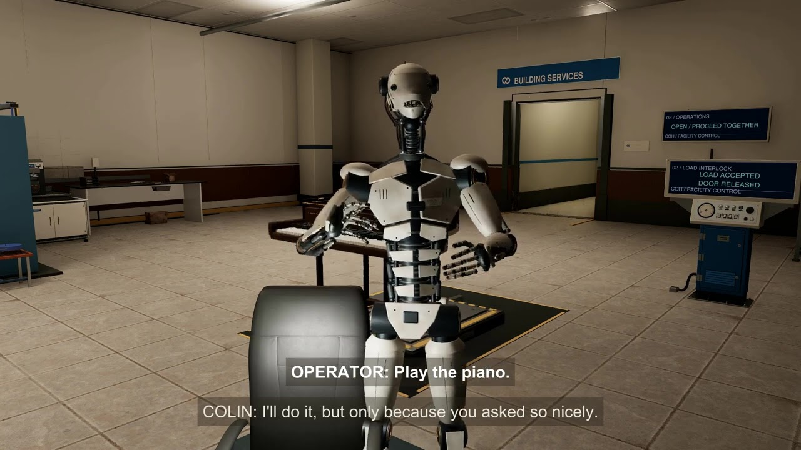
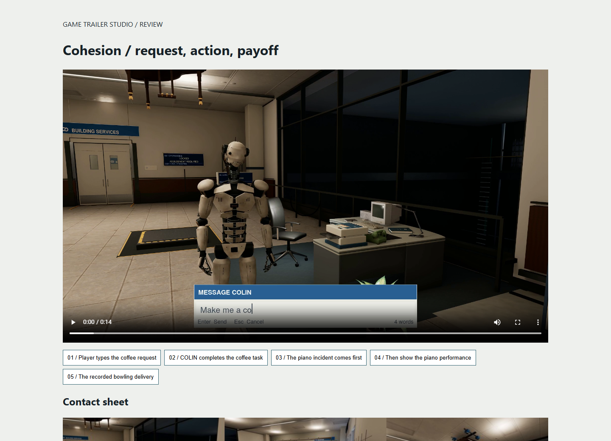
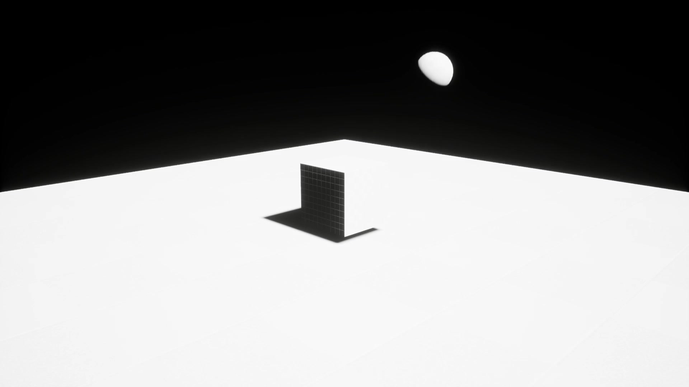
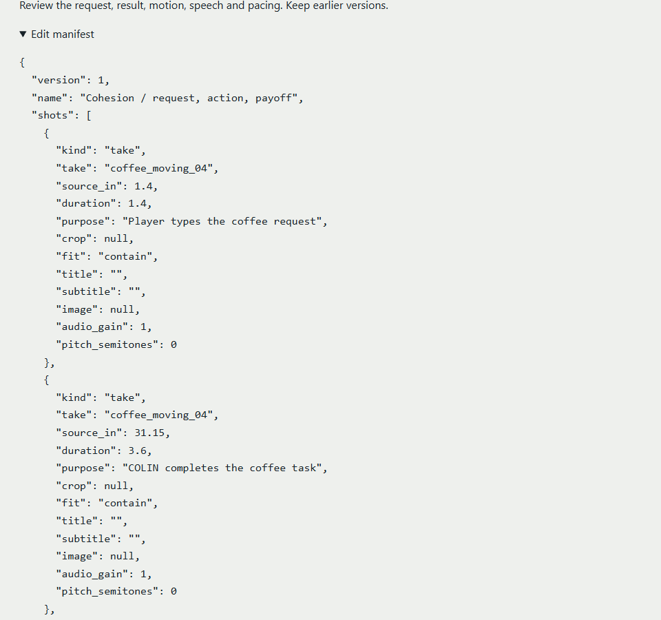

# Game Trailer Studio

**Real gameplay. Editable cuts. Repeatable capture. Developer-directed iteration.**

A reusable agent skill, a Python production CLI and a native **Unreal Engine 5** plugin.
Capture gameplay into immutable takes, select source ranges in JSON, build trailers, review the
result, and re-capture affected shots when your game changes.

The developer chooses the story, tone, music, moments and final cut. An agent can operate the same
inspectable tools you can use manually. There is no model/API subscription required by this toolkit.

## Watch the trailer

[](https://www.youtube.com/watch?v=DRdnVEWdDQw)

**[Watch on YouTube: Cohesion Institute COLIN Project Introduction](https://www.youtube.com/watch?v=DRdnVEWdDQw).**
This is the Cohesion production that inspired the toolkit. GitHub opens the preview on YouTube.
The public toolkit is a separate, reusable implementation of that workflow.

## Included

- Native UE5 viewport recording and master-submix PCM WAV capture.
- Opt-in, process-bound local file bridge; camera staging, smooth moves and subject tracking.
- Real key/character input, markers, registered subjects, and Blueprint/C++ project hooks.
- Shot recipes that wait for observed game state, and retain failed attempts for review.
- Generic video/audio importing for other engines or manual recordings.
- JSON edits: source ranges, crops, fit/cover, title cards, editorial static, music envelopes,
  gain, optional duration-preserving pitch processing, captions and optional subtitle burn-in.
- Source-byte-based cache invalidation, versioned exports, actual full-decode/frame/audio checks.
- Playable HTML reviews, chapter buttons, WebVTT/SRT captions and contact sheets.
- A copyable agent skill, dependency bootstrap scripts, tests, examples and GitHub Actions.



*The toolkit's actual review page. Historical Cohesion takes were imported and rendered into a new
14-second documentation cut; chapter buttons seek the video. [Screenshot sources and gallery](docs/images/README.md).*

## Quick start: a complete cut without Unreal

Requires Python **3.11+**. [uv](https://docs.astral.sh/uv/) is convenient; bootstrap scripts below
also work without uv.

```sh
git clone https://github.com/BigOtis/game-trailer-studio.git
cd game-trailer-studio
uv sync --extra dev --frozen
uv run trailer-studio doctor
uv run trailer-studio init ../my-trailer --name "My Game"
uv run trailer-studio --workspace ../my-trailer demo
uv run trailer-studio --workspace ../my-trailer render edits/demo.json --output exports/demo-v1.mp4
uv run trailer-studio --workspace ../my-trailer review edits/demo.json --video exports/demo-v1.mp4
```

Open `../my-trailer/review/index.html`. The supplied demo is explicitly labelled **synthetic test
patterns**, not gameplay. It exercises the real renderer and audio pipeline before you connect a game.

Without uv:

```powershell
# Windows: creates .venv and installs Python dependencies plus a managed FFmpeg binary.
powershell -ExecutionPolicy Bypass -File scripts/bootstrap.ps1
.venv/Scripts/trailer-studio.exe doctor
```

```sh
# macOS / Linux: Python 3.11+ with venv support is required.
sh scripts/bootstrap.sh
.venv/bin/trailer-studio doctor
```

FFmpeg comes from the `imageio-ffmpeg` platform wheel; PyAV handles media inspection, so a separate
`ffprobe` install is optional. Set `TRAILER_STUDIO_FFMPEG` to use a specific existing binary.
`doctor` reports optional subtitle/rubberband support and whether NVENC is compiled, which does not
establish that an appropriate GPU/driver is present. CPU `libx264` is the default. Supported wheel
availability depends on Python/platform; unsupported platforms need a compatible system FFmpeg.

## UE5 quick start

Unreal Engine is **not downloaded or redistributed**. Install your licensed engine and its normal
C++ toolchain first (Visual Studio C++ tools and Windows SDK on Windows). This repo supplies plugin
source; installing/building it does not require the Unreal Python editor bridge.

```sh
uv run trailer-studio ue install --project "D:/Games/MyGame/MyGame.uproject"
uv run trailer-studio ue build --project "D:/Games/MyGame/MyGame.uproject" --engine "C:/Program Files/Epic Games/UE_5.9" --log ue-build.log
uv run trailer-studio --workspace ../my-trailer ue launch --project "D:/Games/MyGame/MyGame.uproject" --engine "C:/Program Files/Epic Games/UE_5.9" --map /Game/Maps/MyLevel
```

The installer copies **only plugin source/config** into `Plugins/TrailerStudio`, enables it in the
project descriptor and keeps a descriptor backup. It refuses to overwrite an existing plugin.
The build command uses the project's `<ProjectName>Editor` target; custom target names can be built
with your usual Unreal build command instead. Engine lookup also supports `UE_ROOT`, registered
Windows build GUIDs and standard versioned install paths.

Launch prints a `session.json` path. Pass that exact path to subsequent commands:

```sh
uv run trailer-studio ue state --session "PATH/TO/session.json"
uv run trailer-studio --workspace ../my-trailer ue capture recipes/interaction.json --session "PATH/TO/session.json" --take interaction_20261122_01
uv run trailer-studio ue stop --session "PATH/TO/session.json"
```

The launcher selects an isolated user profile, bridge directory and take output root; it never
attaches to an existing human session. The plugin is inert without `-TrailerStudio` and its required
session/output arguments, and its module is excluded from Shipping and Test configurations.
Use standalone `-game` Development sessions. Existing editor/PIE workflows are not a tested capture
mode. Do not run competing gameplay/inference jobs during a human playthrough.

**Game-specific interactions need integration.** Camera and recording commands work generically.
Loading your checkpoint, opening your dialogue UI, issuing a companion task and knowing when that
task succeeded require your Blueprint/C++ hooks. There is no universal "make coffee" command.
[UE5 integration guide](docs/ue5.md) · [Protocol](docs/protocol.md) · [Minimal rendered fixture](docs/ue5.md#run-the-fixture)



*A fresh 1920 × 1080 capture through the native UE5 adapter, using the independent fixture's
floor, cube and physics sphere. The [end frame](docs/images/ue5-native-end.jpg) shows the sphere
after its fall and the camera move. This is the test scene included by the fixture generator.*

## Agent skill

```sh
uv run trailer-studio install-skill --destination ../my-game/.agents/skills
```

Then ask an agent that supports skills:

> Use game-trailer-production. Keep our music, cards and sixty-second structure. Re-capture the
> workshop shots from the current build, using fresh take IDs. Show me a new review cut and explain
> any changed outcomes before we choose the delivery.

Read [the full skill](skills/game-trailer-production/SKILL.md). The CLI is also usable without an
agent. A skill guides the work; it does not provide access to unintegrated game systems.

## Bring your own recordings

```sh
uv run trailer-studio --workspace ../my-trailer import-take workshop_01 --video /recordings/video.mp4 --audio /recordings/audio.wav --build git-revision
uv run trailer-studio --workspace ../my-trailer takes
```

For recordings with embedded audio, omit `--audio`. For silent picture, the renderer provides silence
unless an audio file is supplied. Imports copy sources into new take directories and save hashes;
they refuse existing IDs. `--audio-offset` maps a video timestamp `t` to audio timestamp `t+offset`.

Example `edits/main.json`:

```json
{
  "version": 1,
  "name": "My game — first cut",
  "expected_duration": 8,
  "shots": [
    {"kind": "card", "title": "My Game", "subtitle": "A demonstration", "duration": 2},
    {"take": "workshop_01", "source_in": 3, "duration": 5, "purpose": "Request, action and visible result"},
    {"kind": "card", "title": "My Game", "subtitle": "Your approved call to action", "duration": 1}
  ],
  "captions": [{"start": 2, "end": 4, "text": "Actual recorded dialogue goes here."}]
}
```

Edit paths are relative to the trailer workspace. Source media paths cannot escape it. Durations
must align to output frames. Title artwork can be supplied as `image` on a `card` shot. See
[editing and re-capture](docs/editing.md) for music, captions, crop, pitch and replacement takes.
Machine-readable schemas for editor integration live in [`schemas/`](schemas/).



*The same review page exposes the edit manifest: source ranges, purposes and audio treatment remain
inspectable. Change the JSON file, then render a new version.*

## Refresh after an update

1. Keep the previous build settings, takes and edit.
2. Recheck affected checkpoints, prop state, clear floor space, camera positions and navigation.
3. Run recipes into **new take IDs** and review the observed outcomes.
4. Update selected ranges/captions; changed dialogue or physics can change timing.
5. Render a new export filename and watch its review page.

`retarget` changes take references in a **new** edit file; it does not guess new source in-points or
invent caption alignment. The cache includes source bytes, take metadata, edit treatment, project
settings, renderer source, FFmpeg version and Pillow version, so changing media under an old ID also
invalidates it. Prefer fresh IDs because the provenance is much clearer.

## Verification and limits

```sh
uv run pytest
uv run ruff check src tests
uv run trailer-studio verify ../my-trailer/exports/main-v1.mp4 --duration 60 --fps 30
```

The Python/media test suite renders and decodes real files, checks audible samples, exact frames,
cache replacement/corruption, crop, music and caption burn-in, path boundaries and process binding.
GitHub-hosted CI runs it on Windows and Linux with Python 3.11 and 3.13. Licensed UE integration uses
a separate opt-in self-hosted workflow. [Testing guide](docs/testing.md) and
[sanitized native verification results](docs/verification/ue5-windows-5.9.json).

- Native integration is verified on **Windows / UE 5.9**. Other UE5 versions and macOS/Linux native
  builds are not claimed as tested. Version guards cover some earlier UE APIs, not a compatibility
  guarantee. Python media CI is independent of engine compatibility.
- Capture is real time. CFR files may repeat real rendered frames; this does not create unique
  rendered FPS or make nondeterministic physics/dialogue deterministic.
- Audio is the master mix, not separate dialogue/effects stems. Measure sync on your project;
  hardware and buffer timing vary. Optional pitch affects the selected mix interval.
- Source/derived files are retained. This initial toolkit does not manage cloud storage, multiseat
  capture, an NLE timeline import/export, ASR alignment or distribution-platform uploads.
- Technical verification cannot establish honest outcomes, good pacing, licensing or enjoyable
  storytelling. Review those decisions yourself. Documentation includes credited still screenshots;
  source game assets, video recordings, music and model weights are not included. The toolkit does
  not modify your renderer/inference quality budget.

## Background and license

Created from the workflow described in
[The Future of Game Trailers: A Workflow the Developer Can Direct](https://www.robot-future.com/article/6b030d6ac6e1ad2a9d75d272),
then generalized into a separate implementation and native adapter.

[MIT](LICENSE) for this toolkit. Unreal Engine and downloaded dependencies retain their own licenses;
see [third-party notes](THIRD_PARTY.md). Documentation screenshot rights are described in
[the image credits](docs/images/README.md). No engine binaries are distributed here.
