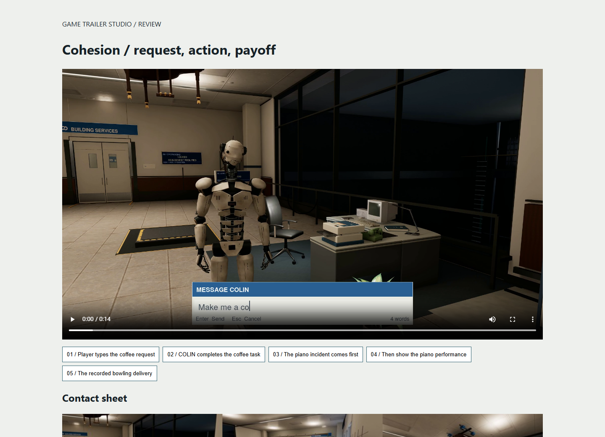
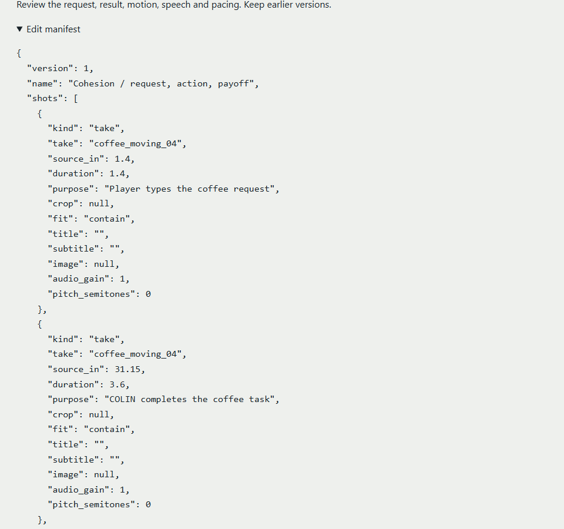
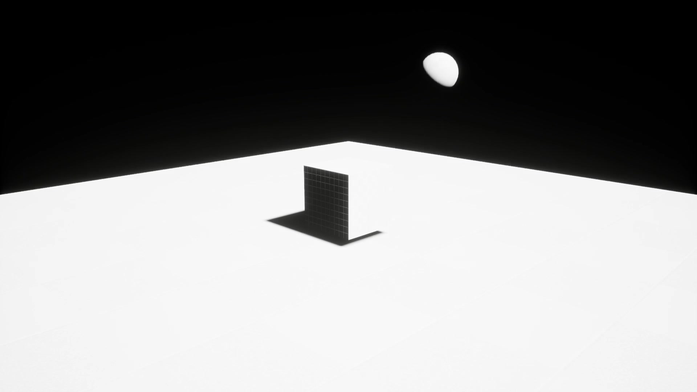
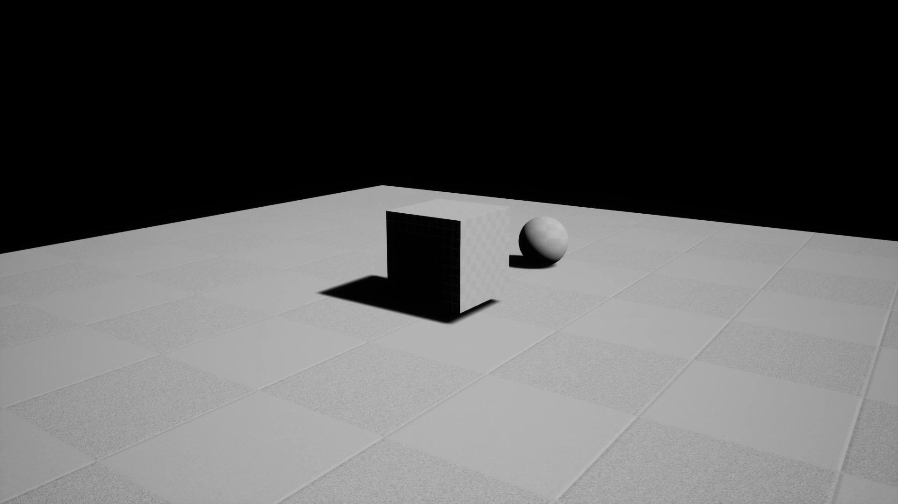
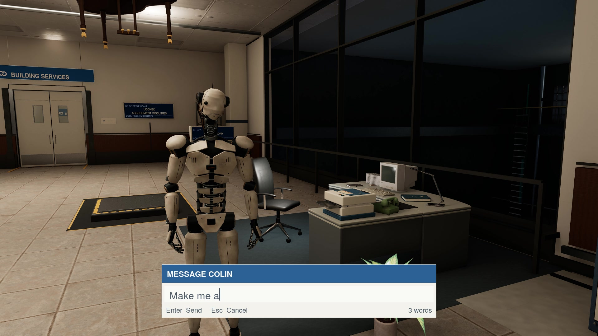
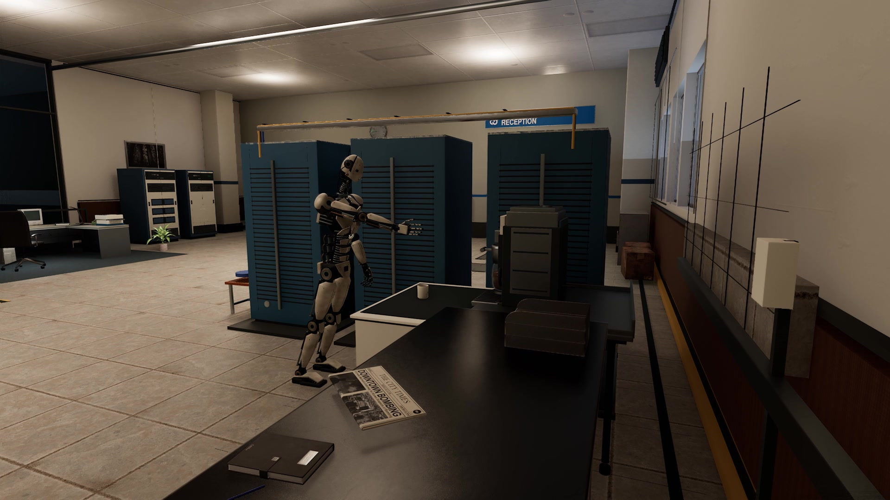
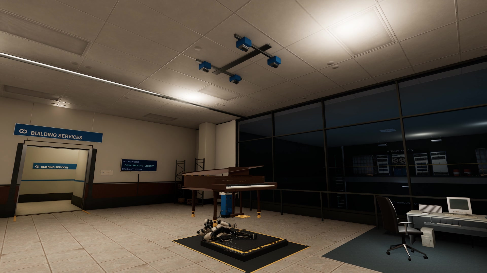
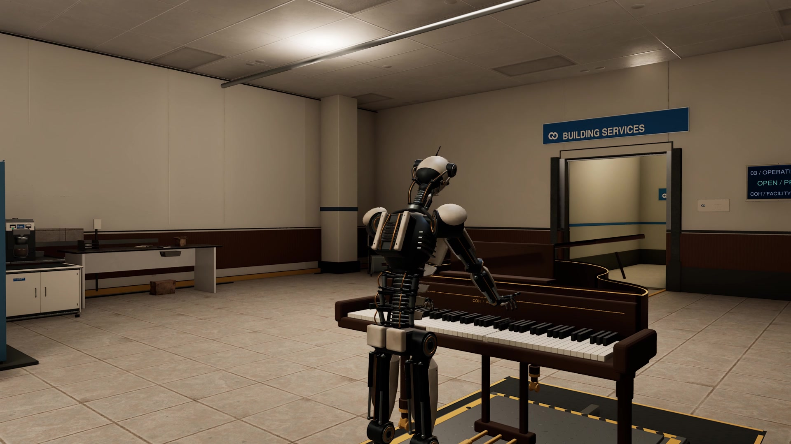
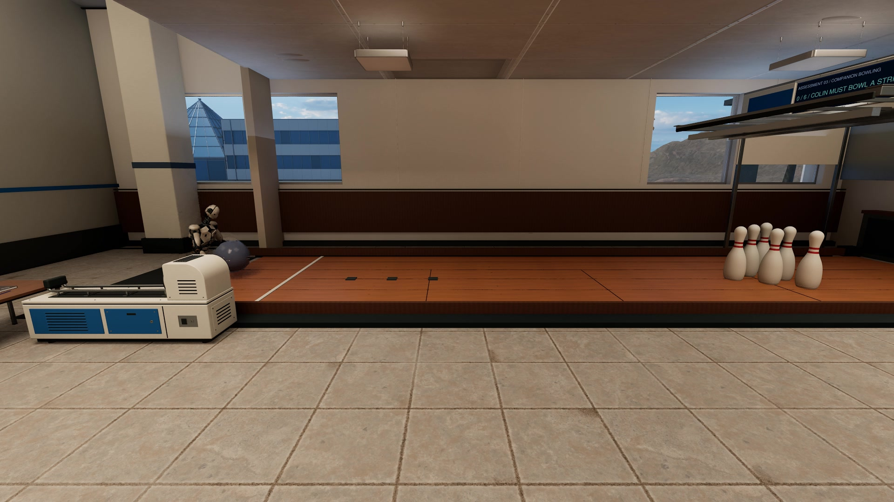

# Screenshots and source notes

These are actual rendered gameplay frames and browser screenshots. No generated concept art,
invented editor controls or staged terminal output is used.

## Review and edit

`review-player.png` was captured from the HTML page produced by `trailer-studio review` on
22 November 2026. Historical Cohesion recordings were imported into the public toolkit, selected
in a new five-shot JSON edit, rendered to a verified 14-second video and opened in a browser.
The screenshot shows active typing; all five chapter buttons operate on the real video.
This documentation cut is separate from the original production trailer.

`edit-manifest.png` shows that page's expanded manifest at a narrower browser width so the text
remains legible. It is the actual parsed edit, including its default treatment fields.

## UE5 native capture

These 1920 × 1080 viewport frames were captured on Windows / UE 5.9 on 22 November 2026 by the
native plugin and `examples/ue5/demo-recipe.json`. The independent generated fixture uses engine
basic shapes; the pictures are decoded from the resulting recording at 0.1 s and 2.2 s. The
launcher used a private profile and the owned game process was stopped afterward.

## Cohesion production examples

The following full-resolution frames come from retained 15 November 2026 gameplay recordings,
without the finished trailer's added subtitles. Game visuals may differ in later builds.

| Image | Source take | Source time |
| --- | --- | --- |
| [Player typing](cohesion-typing.jpg) | `coffee_moving_04` | 2.00 s |
| [Coffee interaction](cohesion-coffee.jpg) | `coffee_moving_04` | 31.00 s |
| [Piano incident](cohesion-piano-impact.jpg) | `piano_fall_01` | 15.15 s |
| [Piano performance](cohesion-piano-performance.jpg) | `piano_moving_01` | 24.00 s |
| [Bowling delivery](cohesion-bowling.jpg) | `bowling_moving_03` | 25.00 s |

`cohesion-trailer-preview.jpg` is the YouTube-provided preview for
[Cohesion Institute COLIN Project Introduction](https://www.youtube.com/watch?v=DRdnVEWdDQw),
published by OtisFuse Productions. It links to that video from the main README.

## Rights

The toolkit's code is MIT licensed. Cohesion game imagery, the video preview and screenshots
containing that imagery are copyright Phil Lopez / Robot Future, included for documentation;
they are not a grant of reusable game-art or footage rights. Unreal Engine and its built-in
content remain subject to Epic's terms. No source game assets or engine binaries are included.
